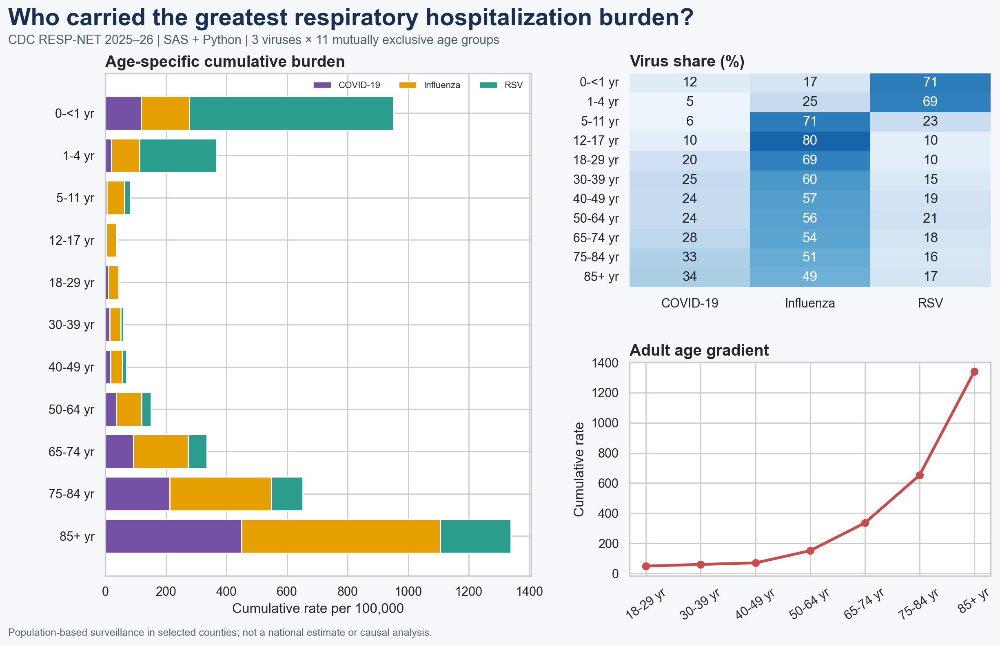

# RESP-NET Age-Specific Respiratory Hospitalization Burden



## Executive summary

This project asks a practical surveillance question: **which age groups carried the greatest cumulative hospitalization burden from COVID-19, influenza, and RSV during the 2025–26 respiratory season, and which virus drove each age profile?**

Using CDC RESP-NET's complete observed cumulative-rate series for 53 weeks, I built a reproducible Python analysis and a substantive SAS validation workflow across 11 mutually exclusive age groups. The analysis separates the three viruses, quantifies age gradients, and validates the calculated combined rates against CDC's separately published combined series.

### Key findings

- Adults aged **85 years and older** had the highest combined cumulative rate: **1,339 hospitalizations per 100,000**, about **27.3 times** the rate among adults aged 18–29.
- Infants younger than 1 year had the second-highest burden: **951 per 100,000**, about **19.4 times** the rate among adults aged 18–29.
- The dominant virus changed with age. **RSV accounted for 71%** of the combined infant rate, while **influenza was the largest component in every age group from 5–11 through 85+**.
- Among seven non-overlapping adult age groups, cumulative burden increased monotonically with age (**Spearman ρ = 1.00**). This is a descriptive ecological pattern across age categories, not an individual-level risk model.
- The three virus-specific components reproduced CDC's published combined rate to within **1.0 hospitalization per 100,000** for every age group; the small differences are consistent with separately rounded published rates.

## Why this matters

An overall respiratory-season total can hide two very different planning needs: prevention and capacity planning for older adults, and RSV-focused protection for infants and young children. The analysis is designed for epidemiologists, immunization programs, hospital preparedness teams, and public-health leaders who need a clear age-by-virus view without implying causation or national representativeness.

## Analytical design

| Element | Choice |
|---|---|
| Population | RESP-NET surveillance catchment, all races and sexes |
| Period | Week ending October 4, 2025 through October 3, 2026 |
| Measures | Observed cumulative hospitalization rates per 100,000 |
| Viruses | COVID-19, influenza, RSV |
| Age groups | 11 mutually exclusive groups from `<1` through `85+` years |
| Primary comparison | Final-season combined cumulative rate by age |
| Validation | Sum of three virus-specific rates vs CDC `Combined` series |
| Sensitivity check | Spearman association between adult age midpoint and burden |

Full details are in [Methods](docs/METHODS.md) and [Data Dictionary](docs/DATA_DICTIONARY.md).

## Visual outputs

| Figure | Purpose |
|---|---|
| [Age burden components](outputs/figures/age_burden_components.png) | Compares cumulative burden and virus composition across age groups |
| [Virus-share heatmap](outputs/figures/virus_share_by_age_heatmap.png) | Shows how the respiratory-virus mix changes with age |
| [Selected age trajectories](outputs/figures/selected_age_trajectories.png) | Compares within-season cumulative patterns for four sentinel age groups |
| [Portfolio preview](outputs/figures/portfolio_preview.png) | Recruiter-ready one-page summary |

## Reproduce the analysis

### Python

```bash
python -m venv .venv
# Windows
.venv\Scripts\activate
pip install -r requirements.txt
python scripts/run_analysis.py
pytest -q
```

The Python workflow downloads the public CDC extract, records a SHA-256 source manifest, applies structural QA, creates analytical tables, cross-checks combined rates, and renders all figures.

### SAS OnDemand for Academics or SAS 9.4

1. Run the Python workflow or use the included `data/processed/resp_net_analytic.csv`.
2. Upload that CSV to SAS OnDemand.
3. Open [sas/resp_net_age_burden.sas](sas/resp_net_age_burden.sas).
4. Change `PROJECT_DIR` to the upload folder and run the full program.
5. Compare `age_burden_summary_sas.csv` with `outputs/tables/age_burden_summary.csv`.

The SAS program is not a placeholder: it performs typed import, date and age derivation, structural QA, final-week cohort construction, long-to-wide reshaping, combined-rate validation, burden ranking, age-specific rate ratios, Spearman analysis, and CSV reporting. See [SAS validation notes](docs/SAS_VALIDATION.md).

## Repository structure

```text
resp-net-age-hospitalization-burden/
├── data/
│   ├── processed/resp_net_analytic.csv
│   └── README.md
├── docs/
├── outputs/
│   ├── figures/
│   ├── tables/
│   └── qa_report.json
├── sas/resp_net_age_burden.sas
├── scripts/run_analysis.py
├── tests/test_outputs.py
├── CITATION.cff
├── LICENSE
└── requirements.txt
```

## Interpretation boundaries

- RESP-NET is population-based surveillance in selected counties and covers roughly 12% of the U.S. population; these results are **not national estimates**.
- Rates are unadjusted and depend on clinician-ordered testing, testing practice, and diagnostic sensitivity.
- Cumulative rates should not be interpreted as hospital-quality measures or causal effects.
- The adult Spearman result uses seven aggregate age groups. It describes a monotonic age pattern and is not individual-level inference.
- Published component and combined rates are rounded, producing cross-check differences of up to 1.0 per 100,000.
- The source contains public aggregate surveillance data and no PHI.

## Data provenance and references

The primary data source is the CDC [RESP-NET Rates and Clinical Data](https://data.cdc.gov/d/kvib-3txy) dataset. Surveillance purpose, coverage, and interpretation guidance come from the [CDC RESP-NET dashboard and methods page](https://www.cdc.gov/resp-net/dashboard/). See [References](docs/REFERENCES.md) for access details.

## Responsible use

This portfolio analysis is educational and descriptive. It should support deeper public-health review, not replace CDC estimates, local surveillance, clinical guidance, or resource-allocation processes.

## Author

**Kira Gor, BDS, MPH**  
Epidemiology · healthcare and clinical data analytics · SAS · Python · SQL · GIS  
[Portfolio](https://gorkira28.github.io/) · [LinkedIn](https://www.linkedin.com/in/dr-kira-gor/)

## License

Code is released under the [MIT License](LICENSE). Source data remain subject to the terms and attribution requirements of their publishers.

